The **1-3-1 zone defense** uses ball pressure and connected rotations to disrupt passing lanes. Its effectiveness depends on how the five defenders adjust their responsibilities as the ball moves.

This guide explains the five roles, the ball-side rotations, the responses to inside catches, and the trade-offs behind the pressure. It follows the same coverage as the Basketball Orbit video and cheat sheet, with more detail on why each movement matters. It is a breakdown of how the system works, not a drill progression or installation plan.

**Our main version:** contain the ball high on the floor, then hard-trap the baseline corner. Extended pressure and non-trapping corner coverage are separate choices, identified below.

For a courtside reference, get the free <a href="https://guide.bballorbit.com/1-3-1-zone-defense" target="_blank" rel="noopener noreferrer">1-3-1 Zone Defense Cheat Sheet</a>. You can also find it in the [Basketball Orbit coaching resources](/resources).

## The setup: five roles, not five fixed spots

The starting shape is one defender above the three-point line, three across the middle, and one near the basket. Once the ball moves, that neat shape disappears. The responsibilities remain connected.

We use the same labels throughout:

- **Top (X3):** steer the ball toward a sideline, obstruct the guard-to-guard reversal, and drop to the high post on a corner pass.
- **Left wing (X2):** cover the left perimeter when the ball is there; protect the weak-side block when it is on the right.
- **Right wing (X4):** perform the mirror-image job on the right.
- **Middle (X5):** deny post entries, adjust with the offensive post, and become the first interior helper against penetration.
- **Baseline (X1):** work between the ball-side block and the corner, cross underneath on a reversal, and prevent a baseline drive on the corner closeout.

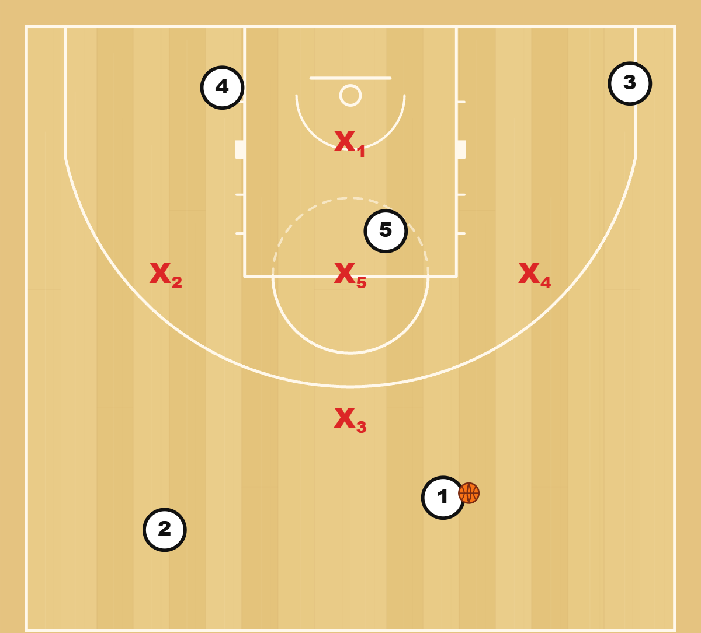

The baseline role is particularly easy to misread. It does not automatically belong to the tallest player. That defender must repeatedly cover ground between corners, recognize inside threats, and communicate. A quick guard may fit it well. Size and strength are often more valuable in the middle, where the defender battles for post position.

The wings need both perimeter mobility and the willingness to work near the rim. **When one wing is up, the other is down.** That relationship is more useful than memorizing two dots on a court.

## What the 1-3-1 is trying to take away

The defense wants the ball on one side and the next pass under pressure.

X3 angles the ball toward a sideline. The other defenders obstruct direct entries and reversals. A passer who has to throw over an active defender, change the passing angle, or pause to find an outlet gives the defense time to rotate.

That does not mean every passing lane can be denied at once. The coverage depends on pressure at the ball and support behind the denial. A fronting post defender, for example, needs someone protecting the lob behind them.

Three principles connect the examples that follow:

1. **Move while the pass travels.** Waiting for the catch makes the next rotation late.
2. **Protect behind the pressure.** A trap or a help step changes the jobs of the other three or four defenders.
3. **Finish the possession.** A difficult shot is not a stop until the defense secures the rebound.

The aim is to make the offense's decisions harder, not to send every defender hunting for a steal.

## Ball high and ball on the wing: different coverage

### While the ball is high on the right

X3 pressures the ball and discourages an easy reversal to the left guard. X4 stays lower, in the route of a direct pass down to the right corner. This is **not** an automatic two-player trap near half court.

Inside, X5 denies the high-post entry. X1 shifts toward the right block, ready to reach the corner if the ball goes there. X2 drops toward the left block to protect behind the front and watch cuts or lobs.

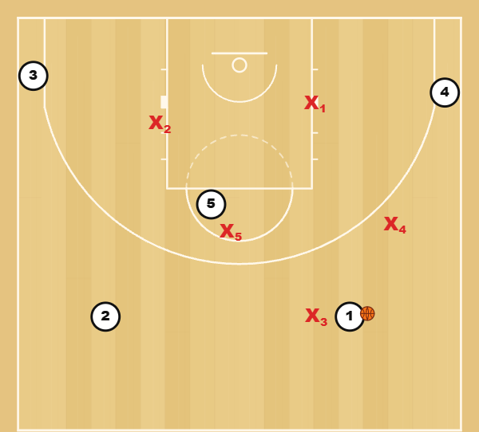

### When the ball comes down to the right wing

Now X4 takes the ball. The approach is from the baseline hip, discouraging the downhill route and encouraging the handler to retreat toward half court. X3 stays in the nearby return passing lane. There is pressure from two directions, but not a tight double-team.

X5 continues denying the post. If the attacker moves down toward the block, X5 adjusts toward the upper side of that low-post position. X1 stays between the ball-side post and the corner. X2 remains the protection behind the front.

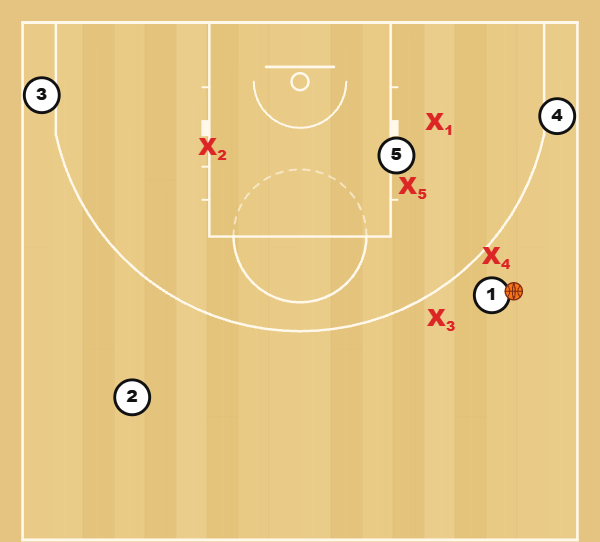

The difference matters: sending X4 up too early while the ball is still high can expose the corner. Leaving X4 low after the wing catch gives the ball handler too much room to see and pass.

## The baseline corner: the trap and the inside exchange

Put the offensive post on the right block and pass from the wing to the right corner. That pass triggers our main half-court trap.

**At the ball:** X1 closes out from underneath and takes away the baseline drive. X4 follows the pass from above. Together they close the space without lunging or opening a route between them.

**Behind the trap:** X5 moves down to front the ball-side low post. X3 drops toward the right elbow to deny the high-post flash. X2 stays near the weak-side block, protecting the basket and the lob behind X5.

  <figure class="m-0">
    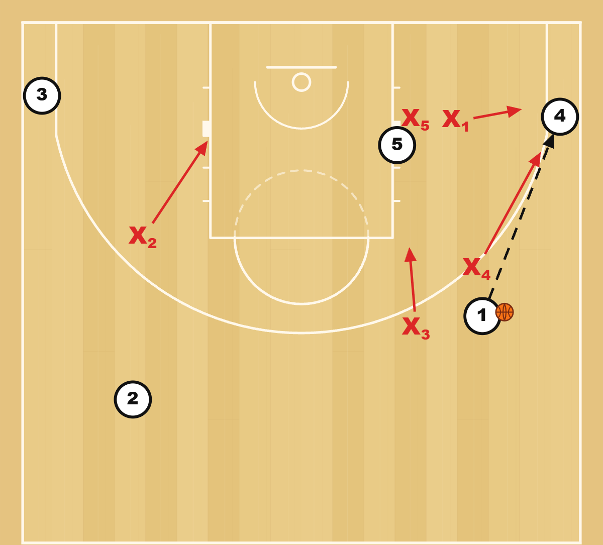
    <figcaption class="text-sm leading-relaxed text-muted-foreground">The corner pass moves all five defenders, not just the two who trap.</figcaption>
  </figure>
  <figure class="m-0">
    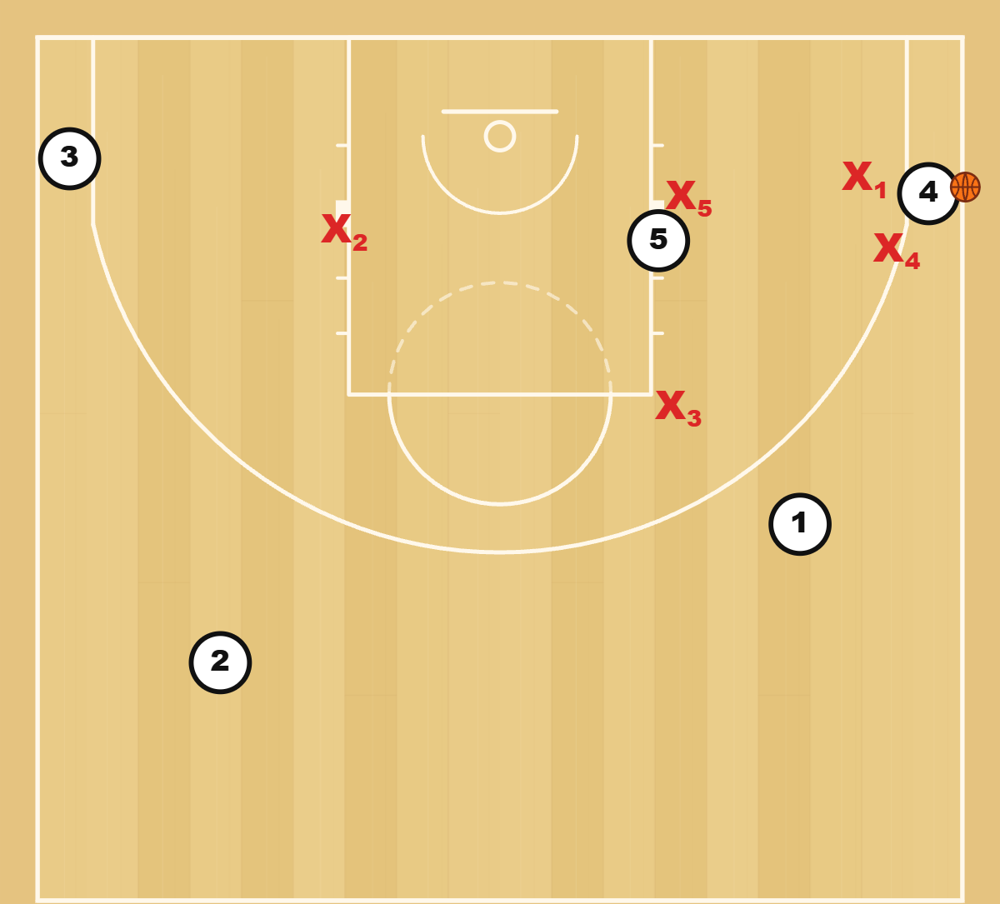
    <figcaption class="text-sm leading-relaxed text-muted-foreground">X5 takes the low post; X3 takes over the high-post area.</figcaption>
  </figure>

That inside exchange is the key. If X5 moves down but X3 stays outside, the offense can flash into an unprotected middle. If X2 leaves the weak-side block to chase the ball, fronting the low post loses its support.

The trapping pair pressures the passer and makes the escape difficult. A deflection may belong to one of the three defenders reading the pass behind them. Reaching for the ball at the expense of balance can undo the trap.

There is a clear cost: **two defenders cover one attacker, leaving three to account for four others.** The trap works only if its pressure makes that numerical advantage difficult to use.

## Ball reversal: exchange the wing responsibilities

Reset with the ball high on the right. The offense reverses it to the left guard.

X3 follows across and obstructs the return pass. X2 comes up from the weak-side block, while X4 drops toward the new weak-side block. X1 crosses underneath to the left block. X5 adjusts the post denial to the new ball side.

X2's route matters. A straight sprint at the receiver can leave the pass to the left corner open while X1 is still crossing the floor. Instead, X2 uses a **curved closeout through the corner passing lane**, then approaches the ball.

  <figure class="m-0">
    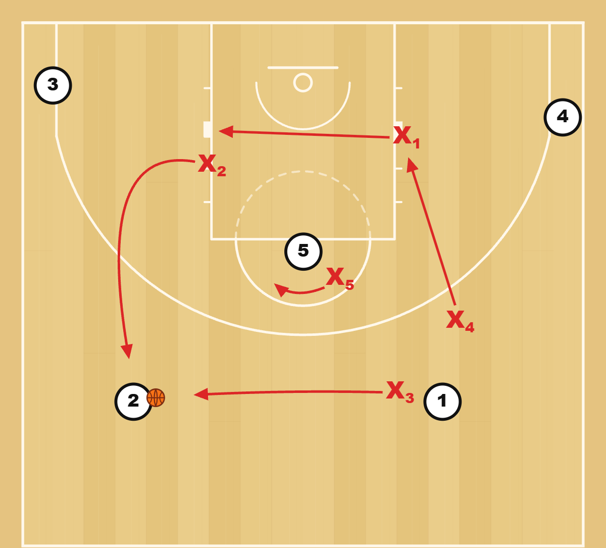
    <figcaption class="text-sm leading-relaxed text-muted-foreground">The curved route obstructs the next pass while the baseline defender crosses.</figcaption>
  </figure>
  <figure class="m-0">
    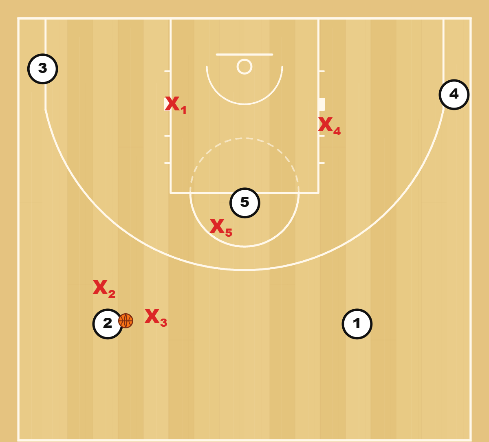
    <figcaption class="text-sm leading-relaxed text-muted-foreground">The original responsibilities reappear on the opposite side.</figcaption>
  </figure>

The defense has not changed systems. It has changed which wing pressures the ball and which wing protects behind the post.

## Skip passes: the landing spot changes the response

A skip pass bypasses the normal sequence and forces longer recoveries. A pass to the opposite corner and a pass to the opposite wing create different immediate problems.

### Skip from the right wing to the left corner

X2, already near the weak-side block, is the first defender out. The closeout takes away the baseline drive. X1 sprints across to join the play.

In our trapping version, X2 and X1 form the new corner trap. In a non-trapping variation, X1 takes over the corner and releases X2 upward. Those are different coverage choices, not two instructions to perform simultaneously.

X5 shifts to the new ball-side low post. X4 drops toward the opposite block. X3 shifts across the high-post area, ready to help if the receiver immediately passes up to the left wing.

  <figure class="m-0">
    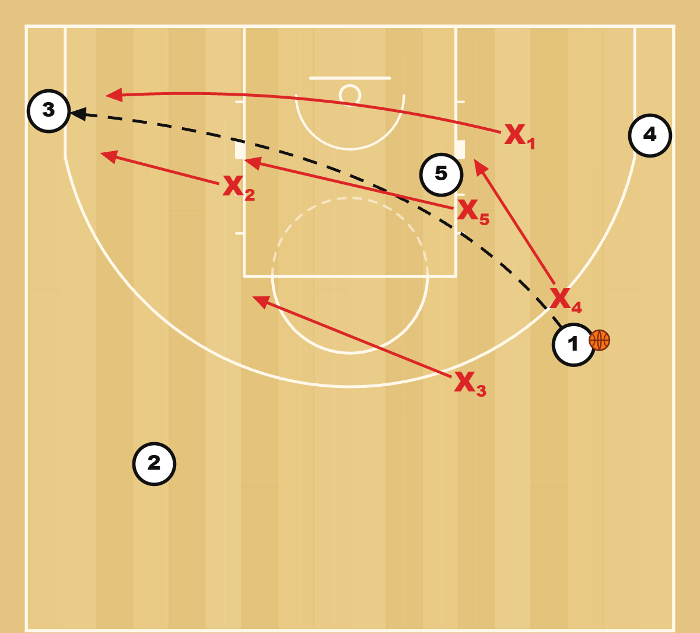
    <figcaption class="text-sm leading-relaxed text-muted-foreground">The weak-side wing handles the first closeout; the baseline defender travels across.</figcaption>
  </figure>
  <figure class="m-0">
    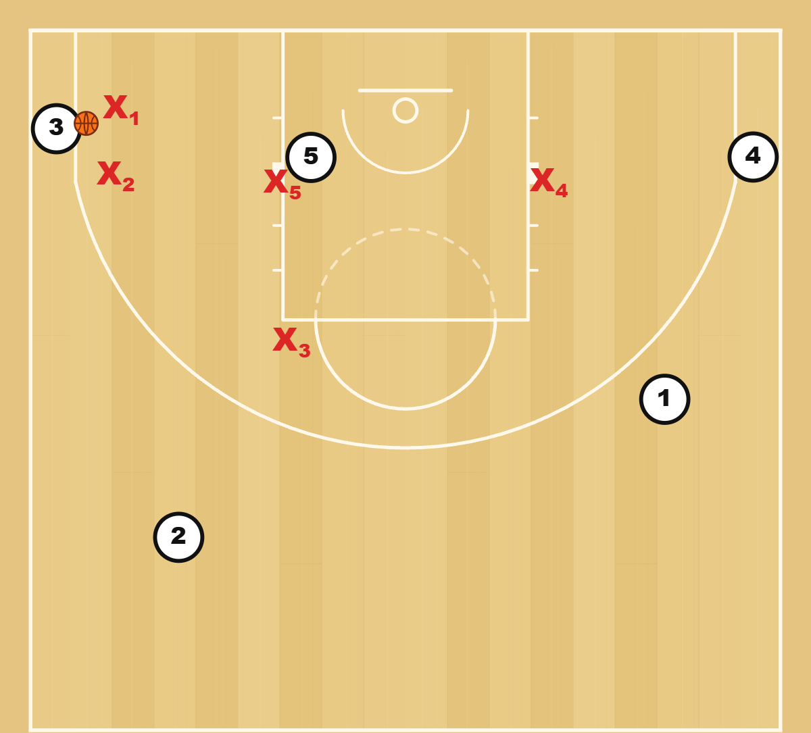
    <figcaption class="text-sm leading-relaxed text-muted-foreground">Our main trapping version finishes with two defenders in the new corner.</figcaption>
  </figure>

### Skip from the left side to the right wing

Now X4 closes out from the weak-side block. The immediate concern is the next pass down to the right corner. X4 approaches through that passing lane rather than running directly at the receiver.

X1 crosses underneath. X3 shifts toward the new ball side, X5 adjusts the post denial, and X2 becomes the weak-side interior protector.

  <figure class="m-0">
    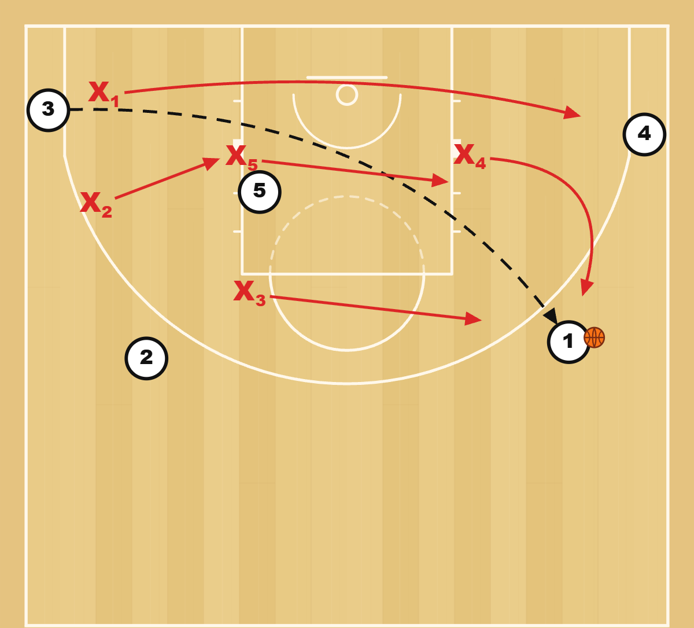
    <figcaption class="text-sm leading-relaxed text-muted-foreground">The first recovery must account for the second pass.</figcaption>
  </figure>
  <figure class="m-0">
    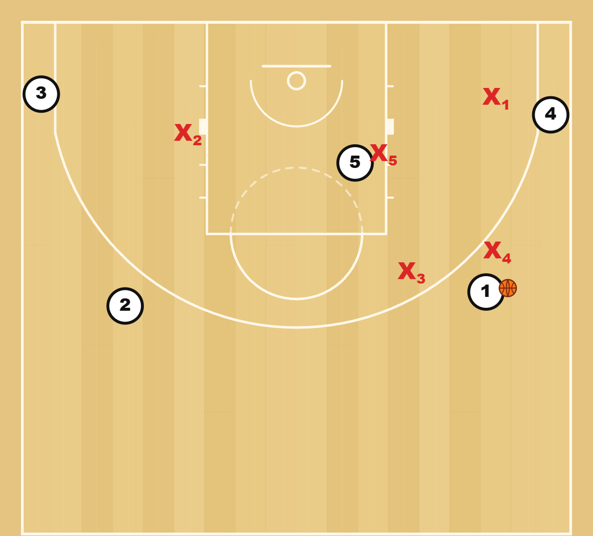
    <figcaption class="text-sm leading-relaxed text-muted-foreground">Once the baseline defender arrives, the familiar ball-side coverage is restored.</figcaption>
  </figure>

For a coach facing the zone, this is an important distinction: the skip itself may not create the best advantage. The quick pass after it may catch the defense before its inside coverage arrives.

## When the ball gets inside

Post denial and passing pressure will not prevent every entry. The defense needs a response after the initial coverage is beaten.

### High-post catch: double above, protect below

An entry from the right reaches an attacker near the free-throw line. The receiver can now see both sides of the floor and the space behind the defense.

X5 contains from the basket side. X3 closes down from above to double the catch and encourage a pass back toward the top.

Below them, **X1 and the left wing (X2) protect the two sides of the basket. X4 stays connected to the nearby right-side perimeter outlet.** Do not pull that wing into the same space as the double and leave the outlet unattended.

If the ball goes back to the top, X3 recovers upward and X5 stays inside. If it skips to the left wing, X2 uses the curved closeout again.

  <figure class="m-0">
    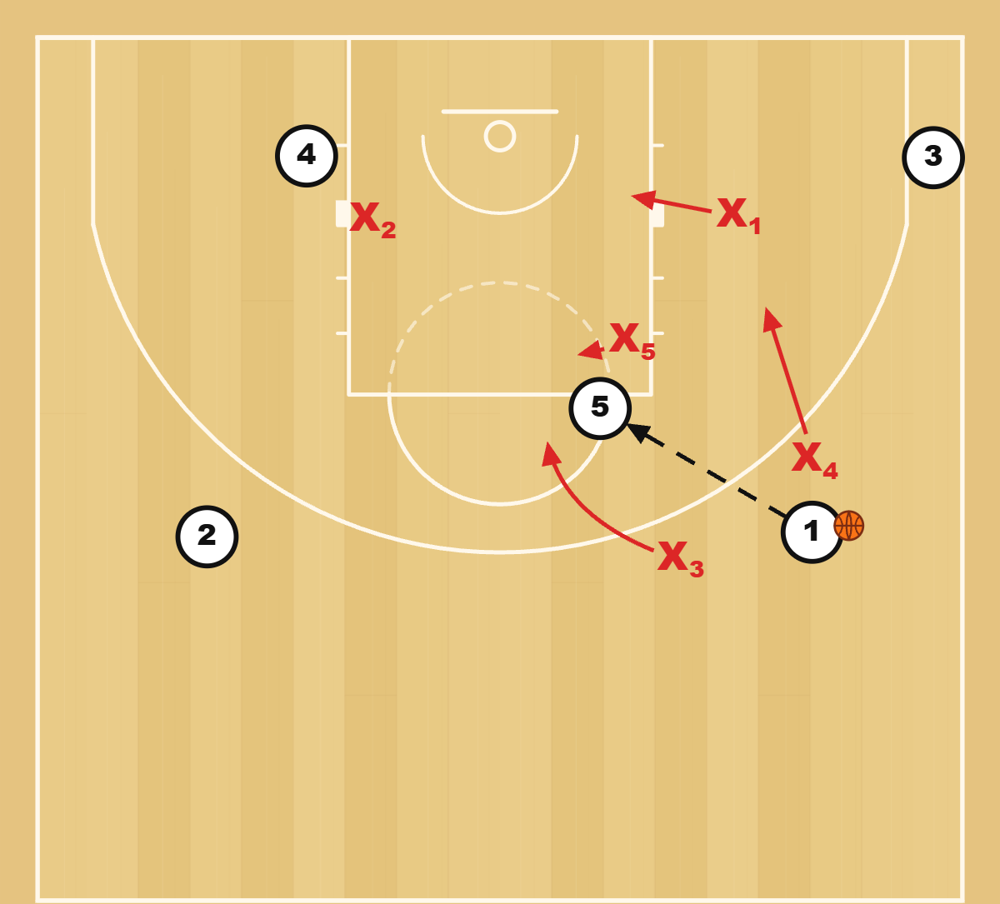
    <figcaption class="text-sm leading-relaxed text-muted-foreground">Pressure above the ball depends on coverage below it.</figcaption>
  </figure>
  <figure class="m-0">
    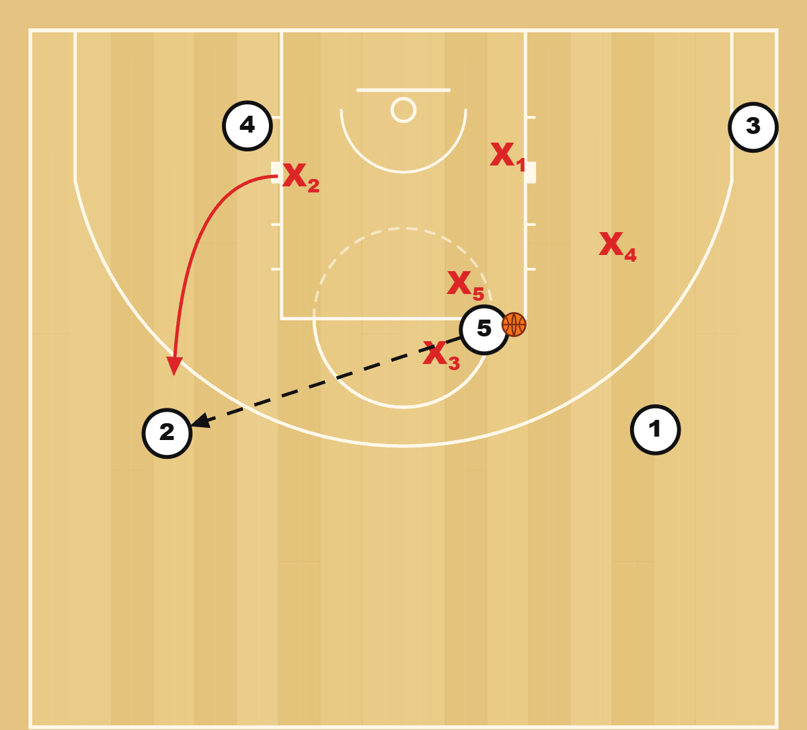
    <figcaption class="text-sm leading-relaxed text-muted-foreground">The pass out releases the next rotation; the double is not a permanent position.</figcaption>
  </figure>

The vulnerable moment is before the second defender arrives. A quick high-low pass or a cutter behind the pressure can reach the rim before the coverage tightens.

### Low-post catch: brief help, not an automatic full double

Suppose the entry reaches the right block and X5 ends up behind the receiver. This is a recovery situation after the front has been beaten, not the intended starting position.

X5 contests from the basket side. X1 gives brief help at the ball while preserving a route back to the corner shooter. X3 protects the high post, X4 watches the wing outlet, and X2 covers the weak-side block.

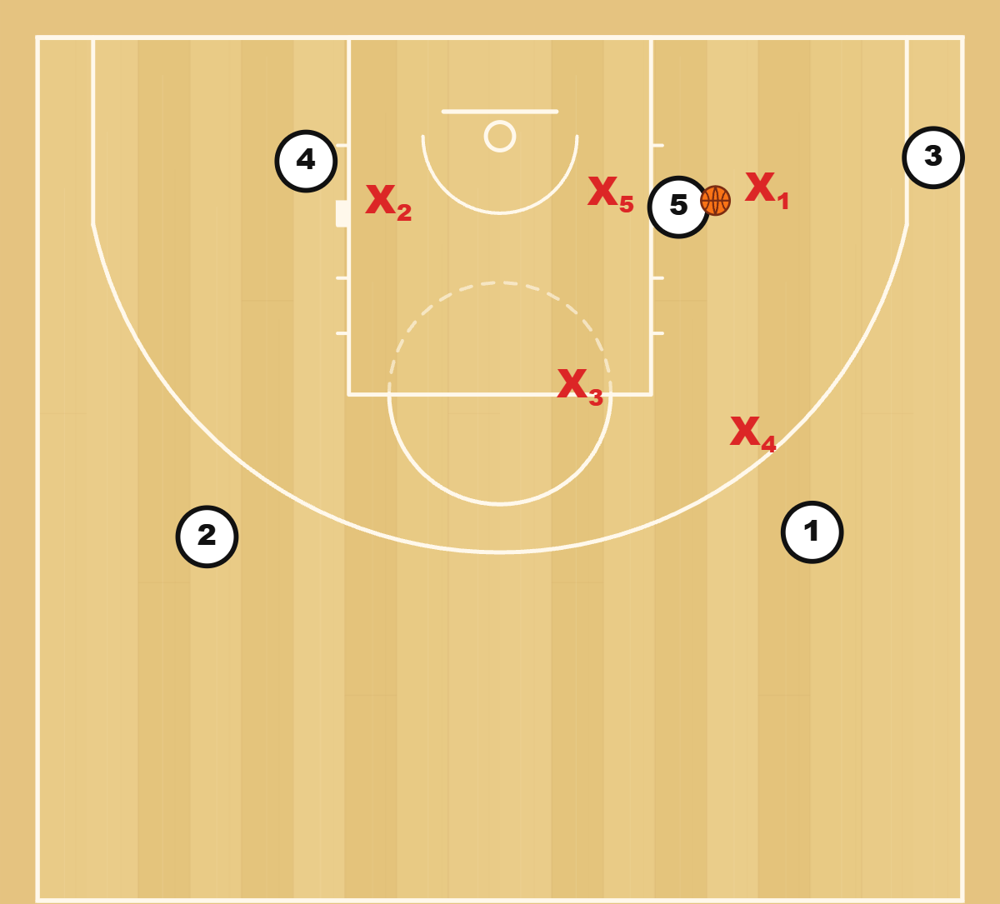

The distinction is commitment. A short dig can pressure the catch. Staying in a full double can leave the corner open on the pass back out. The baseline defender cannot treat both jobs as if they require the same position.

### Dribble penetration: stop the ball and fill behind the helper

If the handler drives between X3 and X4, X5 steps up to stop the penetration. That movement opens space behind X5.

X1 and X2 tighten toward the basket to protect it. The beaten top and right-wing defenders recover and make the next pass difficult. On the pass out, the defense spreads back into the responsibilities for the new ball side.

  <figure class="m-0">
    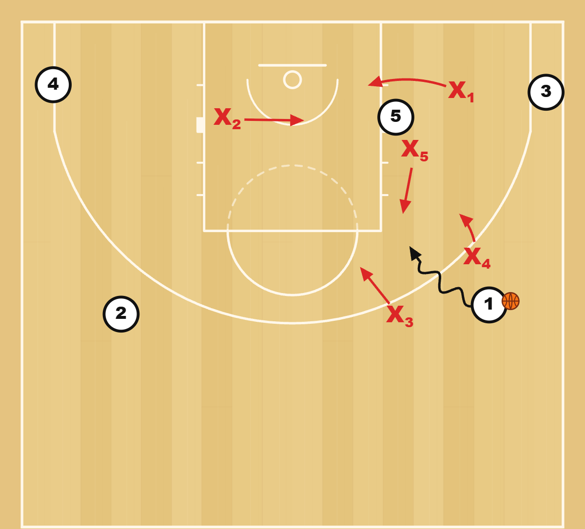
    <figcaption class="text-sm leading-relaxed text-muted-foreground">X5 stopping the drive changes the other defenders' responsibilities.</figcaption>
  </figure>
  <figure class="m-0">
    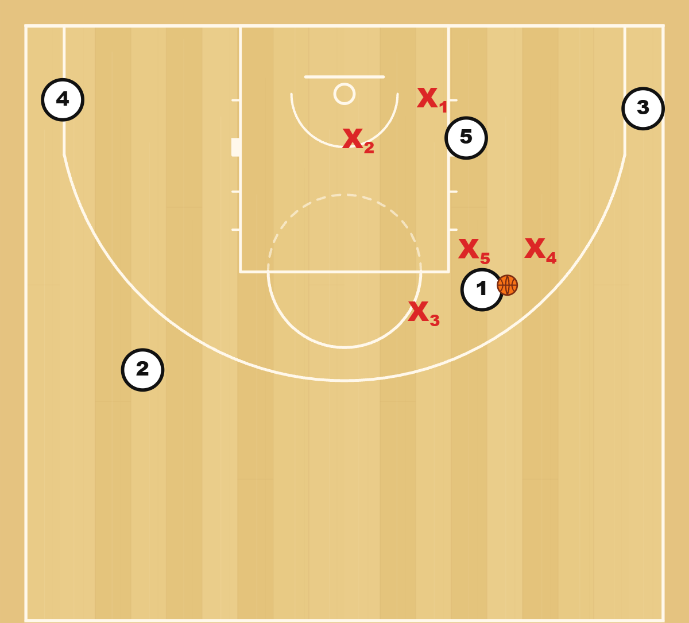
    <figcaption class="text-sm leading-relaxed text-muted-foreground">The original shape gives way to help and recovery, not five stationary spots.</figcaption>
  </figure>

Every help step exposes another passing option. Pressure at the ball and recovery on the pass are what keep that option from becoming an uncontested finish.

## Extended pressure: a separate three-quarter-court option

So far, the defense has contained high and trapped in the baseline corners. Extending into three-quarter court changes where the pressure begins.

X3 picks up earlier and steers the dribbler toward a sideline. As the ball crosses half court, the ball-side wing steps up.

In a **soft trap**, the two defenders leave some space around the dribbler. The wing obstructs the route down the sideline; X3 discourages the reversal. The aim is to restrict the next action without immediately closing a hard double around the ball.

In a **hard trap**, both defenders close that space. The other three move into likely escape lanes, accepting more risk to contest or intercept the pass.

  <figure class="m-0">
    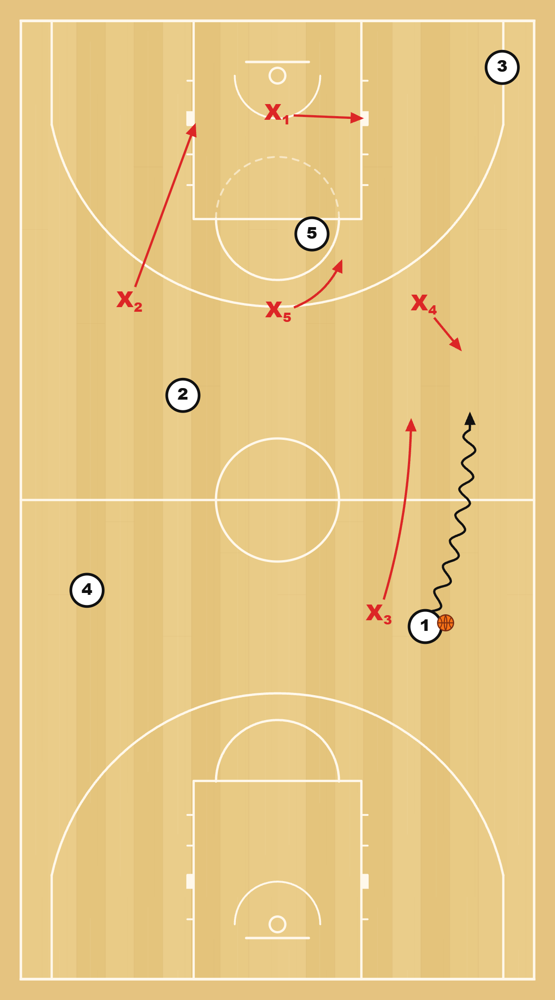
    <figcaption class="text-sm leading-relaxed text-muted-foreground">Earlier pickup leads into soft pressure near halfway, with three defenders behind it.</figcaption>
  </figure>
  <figure class="m-0">
    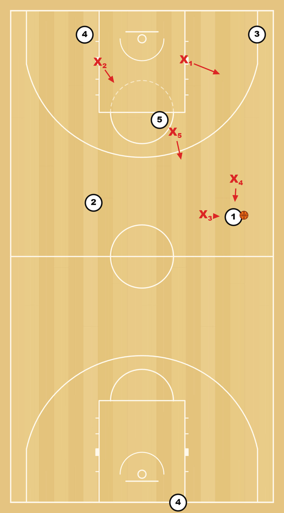
    <figcaption class="text-sm leading-relaxed text-muted-foreground">Hard pressure closes the ball but asks the back three to cover more exposed space.</figcaption>
  </figure>

Behind the softer pressure, X5 protects the high-post area, X1 covers the ball-side block, and the opposite wing protects near the weak-side block. In either version, a clean escape can leave the offense attacking space behind two defenders.

This can change a game's rhythm or increase the pressure when a team needs possessions. It is not simply a better version of the half-court coverage. It trades more court behind the ball for earlier disruption.

If you are preparing to face that extension, the [press-break guide](/blog/press-break) covers the broader spacing and passing principles against pressure. Here, the key identification is which players step up, where the trap closes, and what remains behind it.

## Rebounding: all five finish the possession

Return to the right-corner trap and let the shot go up.

X5 establishes ball-side rebounding position. X2 finds a threat on the weak side. X3 comes down to support that same weak side.

Of X1 and X4, one contests the shot and the other moves in to help rebound. The contesting defender also accounts for the shooter. Which player contests depends on who is in position to do so; both cannot assume it is the other's job.

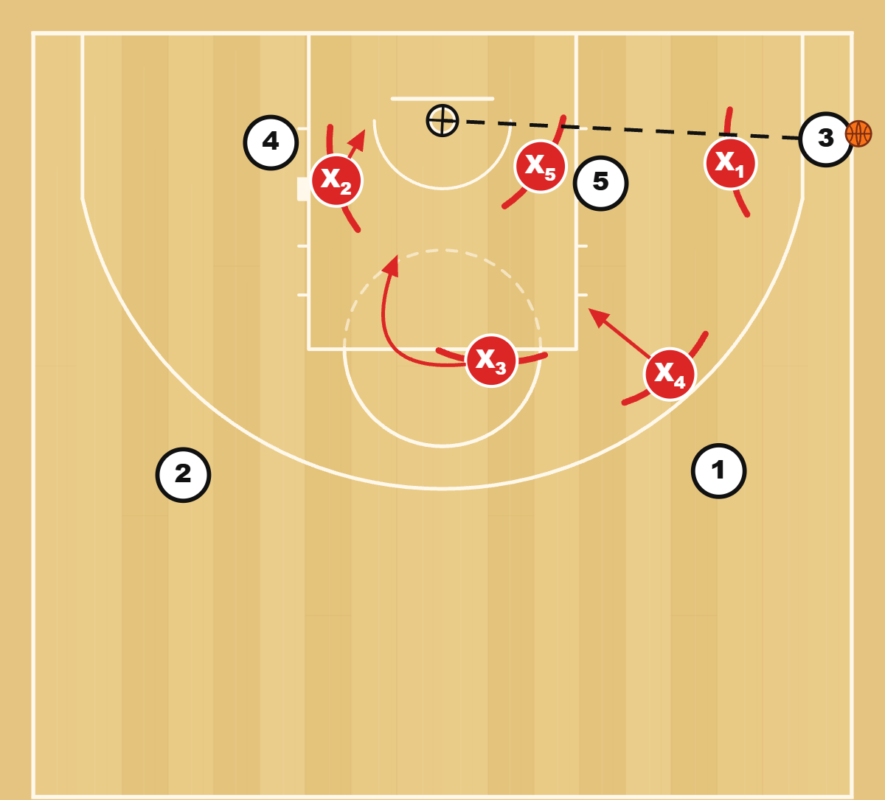

**Find opponents as well as positions.** Reaching a block or turning toward the rim does not stop an attacker running through the next gap. The defense must locate those threats, establish rebounding position, and pursue the ball. Nobody leaves early expecting the pressure to have finished the job.

## Strengths, weaknesses, and the breakdowns to recognize

The 1-3-1 can disrupt familiar passing patterns, force uncomfortable decisions, and create deflections that lead into transition. Its changing responsibilities can also make the defense harder to read than its starting alignment suggests.

Those benefits have costs:

- **High-post access:** a clean catch lets the receiver see both sides and play behind the pressure. The double must arrive with low coverage already moving.
- **Corner coverage:** the corner is a trap location, but also a long recovery for X1. A late first closeout can turn the intended pressure into an open shot or baseline drive.
- **Skip pass plus second pass:** the wing's recovery must obstruct the next pass while the baseline defender crosses.
- **Space behind help:** fronting, trapping, and stopping a drive all need protection behind them. A defender leaving that support to chase a steal can expose the rim.
- **Rebounding and repeated long recoveries:** this is demanding work. Late movement or watching the shot can give away the possession the pressure nearly won.

If you are scouting an opponent, do not stop at “they play 1-3-1.” Watch the actual rules: Do they contain or trap high? Does the baseline defender take the corner alone or with the wing? What happens on a high-post catch? The answers reveal the coverage you are facing.

## Key takeaways

1. **Read the roles, not just the shape.** X3, X5, X1, and the two wings exchange responsibilities as the ball moves.
2. **Separate high containment from corner trapping.** Our main version does not automatically double the ball near half court.
3. **Watch the inside exchange on the corner pass.** X5 takes the low post; X3 takes the high post; the weak-side wing protects behind the front.
4. **Account for the next pass.** Curved wing closeouts obstruct the corner while X1 crosses underneath.
5. **Distinguish the inside responses.** High-post catch: X3 and X5 double. Low-post recovery: X1 helps briefly. Drive: X5 stops the ball and the low defenders fill behind.
6. **Treat extended pressure as a deliberate option.** More pressure at the ball means more space to protect behind it.
7. **Secure the rebound with all five.** A pressured shot is only part of the stop.

## Watch the rotations and keep a quick reference

The [animated 1-3-1 Zone Defense breakdown on YouTube](https://www.youtube.com/watch?v=FHlkZy5N5eo) walks through the same situations in motion.

<iframe src="https://www.youtube-nocookie.com/embed/FHlkZy5N5eo" title="1-3-1 Zone Defense Explained: Rotations, Traps and Weaknesses" loading="lazy" allowfullscreen></iframe>

For a shorter reference beside your notes, the free <a href="https://guide.bballorbit.com/1-3-1-zone-defense" target="_blank" rel="noopener noreferrer">1-3-1 Zone Defense Cheat Sheet</a> puts the roles and rotations into a page-by-page guide. Use the article for the reasoning, the video for movement, and the PDF to find a specific situation quickly.

## Draw the coverage for your team

Before turning a system into a practice, make its coverage choices explicit: where pressure starts, when two defenders commit, and who protects behind them. The [basketball practice-planning guide](/blog/basketball-practice-planning) explains how to connect a clear focus with the rest of a session.

  

    <h3 class="mt-0 !text-primary">Make the rotations clear before you step on court</h3>
    
Use the Drill Creator in the Basketball Orbit app to draw your own 1-3-1 coverage, show the movement on a pass, and make your team's trapping choices visible.

    
The <a href="https://app.bballorbit.com/">Practice Planner</a> gives those visuals a place within your session, alongside the coaching cues and timing you want to keep in view.

    
<a href="https://app.bballorbit.com/">Draw your rotations in Basketball Orbit</a>

  

  

    <a href="https://app.bballorbit.com/">
      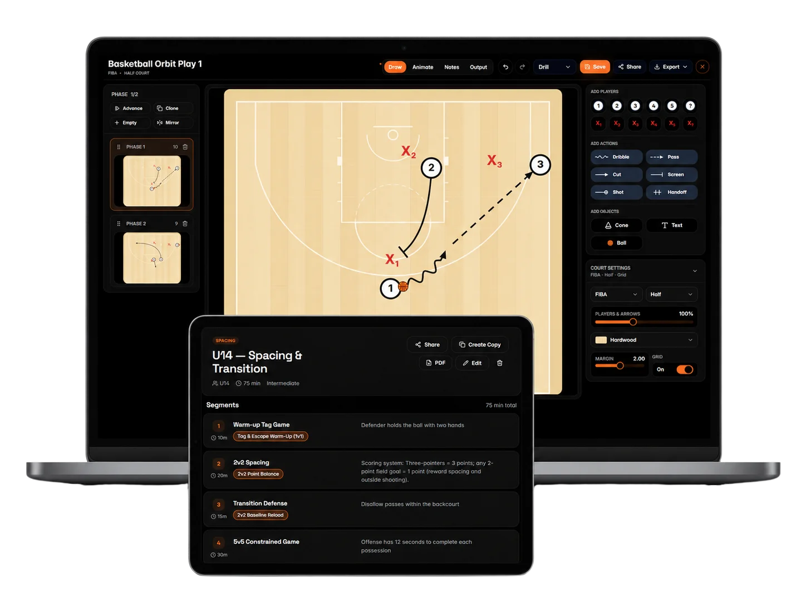
    </a>
  

