The **Horns offense** gives a team several ways to create an advantage from the same starting alignment: a ball handler at the top, two players at the elbows, and two in the corners. From there, the offense can flow into ball screens, handoffs, split cuts, high-low passes, and Zoom action.

The coaching challenge is making those options connect. If both bigs roll into the same space, or the next screen arrives before the first action develops, a promising setup becomes a crowded possession.

This guide follows the actions in the Basketball Orbit Horns video, with diagrams and explanations of the spacing, timing, and reads behind each variation. Watch the movement below, then use the sections that follow to study the details.

<figure class="m-0 my-8">
  <a href="https://www.youtube.com/watch?v=TX8U5Zav8e4" target="_blank" rel="noopener noreferrer">
    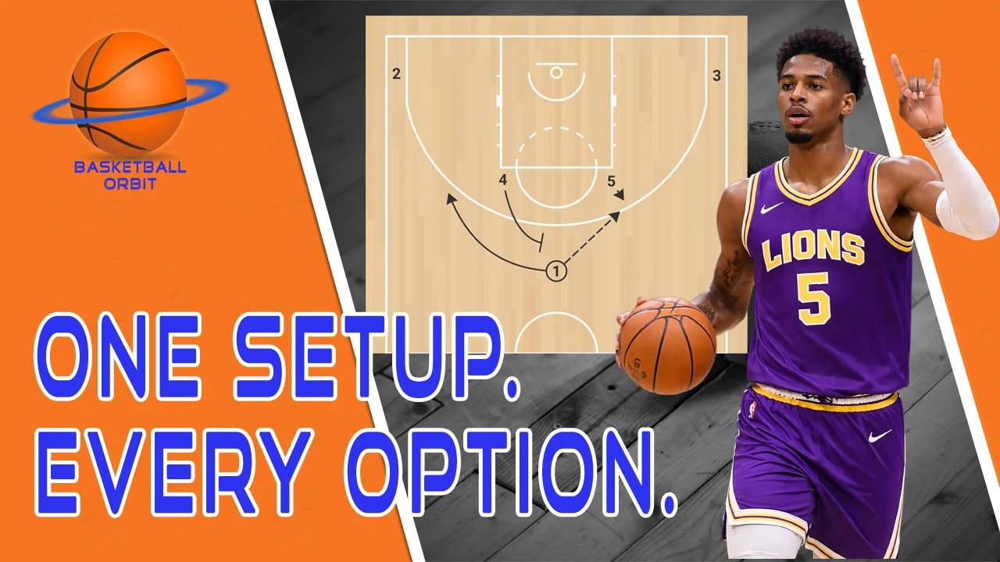
  </a>
  <figcaption class="text-sm leading-relaxed text-muted-foreground">Watch the Horns actions in motion: <a href="https://www.youtube.com/watch?v=TX8U5Zav8e4" target="_blank" rel="noopener noreferrer">open the full video on YouTube</a>.</figcaption>
</figure>

For a reference beside your coaching notes, get the free <a href="https://guide.bballorbit.com/horns" target="_blank" rel="noopener noreferrer">Horns Offense PDF Guide</a>.

## The Horns setup and the two main entries

In the diagrams, **1** handles the ball, **4 and 5** occupy the elbows, and **2 and 3** provide corner spacing. The elbow players can step higher to set the ball screens at the angle and distance the possession needs.

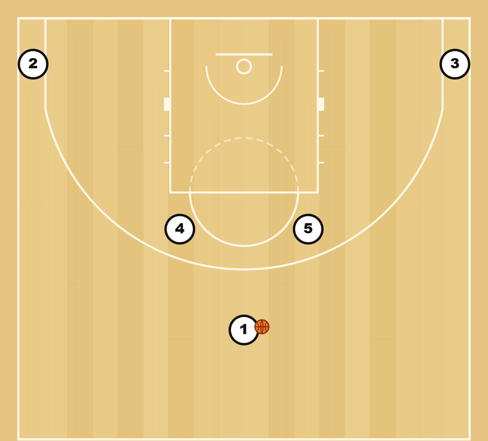

The two elbow players are often the team's bigs, but those spots describe jobs. A mobile forward, a strong passing wing, or a guard who creates a useful screening matchup can fill one of them. Choose players who can execute the next action, rather than assigning the spots only by height.

Most of the options here begin in one of two ways:

- **Keep the ball with 1:** the elbow players step up, giving the handler a screen on either side.
- **Enter to an elbow:** 1 passes to 4 or 5, shifting the next decision to a high-post passer while teammates cut and screen.

Both entries begin from a recognizable shape. What happens after the entry depends on the action, the personnel, and the defense.

The corners give those actions room. If their defenders help toward the lane, the offense can look for the pass out. If the corner players drift inward without a purpose, their defenders can help closer to the ball while recovering a shorter distance.

## Pick-and-roll and pick-and-pop: coordinate the two bigs

Both elbow players come up to screen on opposite sides of the on-ball defender. The ball handler can choose a direction, taking account of the defender's stance, the screen angle, and the matchup.

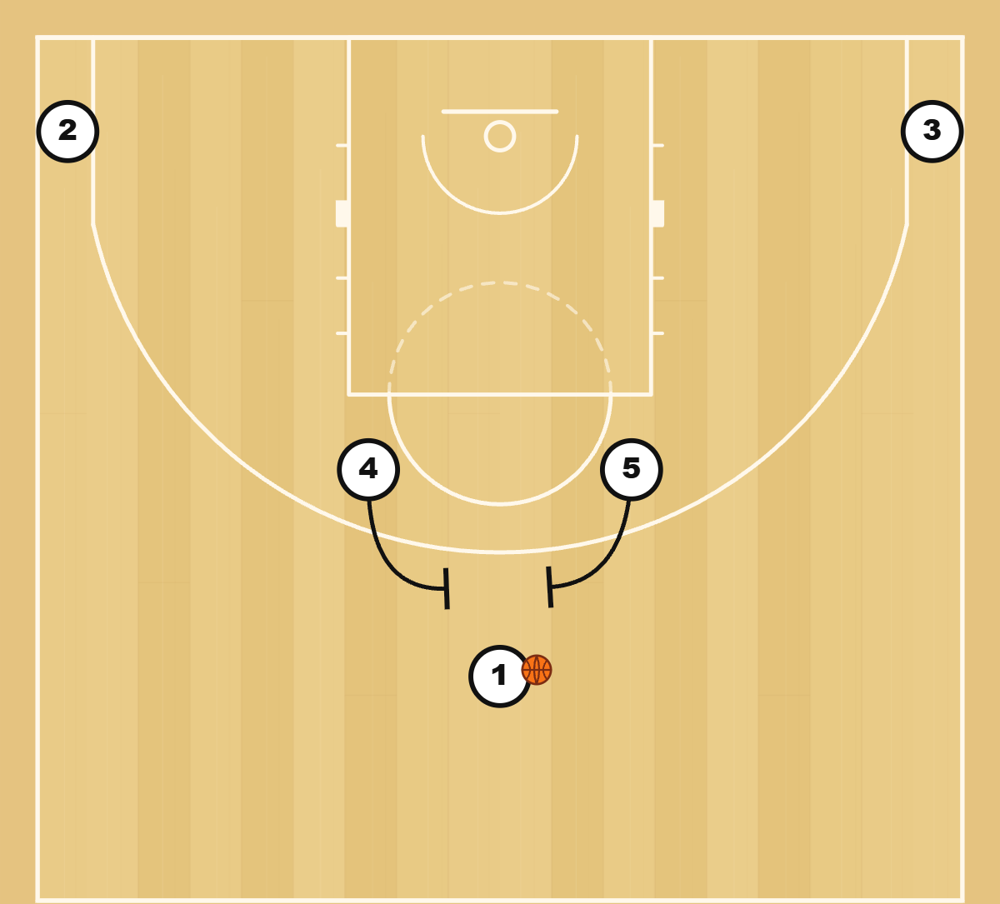

After the handler uses a screen, the relationship between 4 and 5 creates the spacing.

### Pick-and-roll

In the first version below, **1 uses 4's screen, 4 rolls, and 5 pops out**. The roll threatens the rim. The pop gives the ball handler a perimeter outlet and asks the second big's defender to account for another space.

### Pick-and-pop

In the second version, **4 pops after screening and 5 dives**. The ball handler still has an interior target, but a different player provides it. This can suit a shooting screener and a stronger interior finisher on the opposite side.

  <figure class="m-0">
    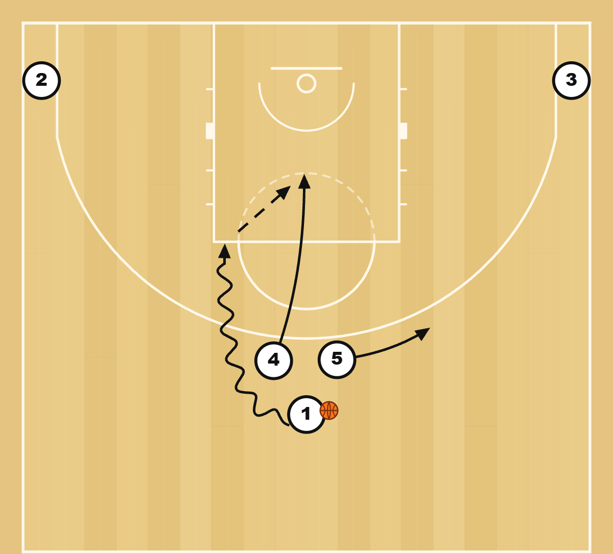
    <figcaption class="text-sm leading-relaxed text-muted-foreground">Pick-and-roll: 4 attacks the rim while 5 creates the outside outlet.</figcaption>
  </figure>
  <figure class="m-0">
    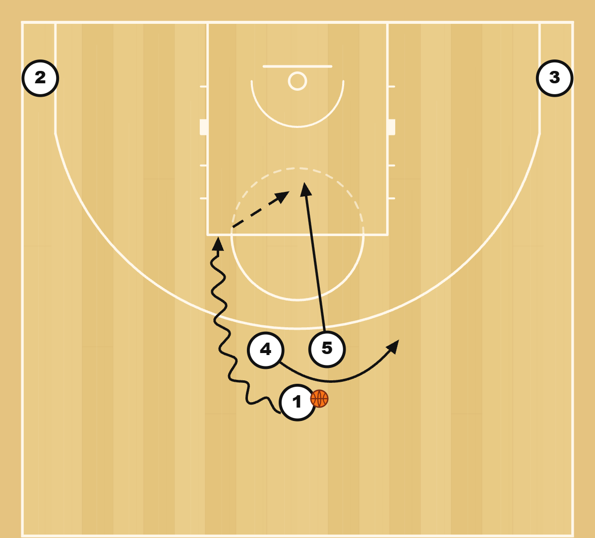
    <figcaption class="text-sm leading-relaxed text-muted-foreground">Pick-and-pop: 4 stays outside and 5 supplies the basket threat.</figcaption>
  </figure>

**One player threatens inside; the other provides space outside.** That is the organizing principle for these variations. Agree on the initial responsibilities so both bigs do not dive into the same passing window.

The handler then reads the coverage. A retreating defender may allow a drive or pull-up; a second defender committing to the ball may free the roller or popper. If a corner defender tags the roll, the corner pass becomes part of the decision. The alignment creates options, but it does not guarantee that any particular pass is open.

## Re-screen or twist: make the second screen arrive on time

When the first screen produces no clear advantage, the second big can screen the ball in the other direction. This continuation is often called a **Horns twist** or a re-screen by the second big.

Here, 1 uses 4 first. As the handler comes out on the left, 5 arrives to change the angle of attack. The on-ball defender must navigate another screen while the defense reorganizes behind the first one.

  <figure class="m-0">
    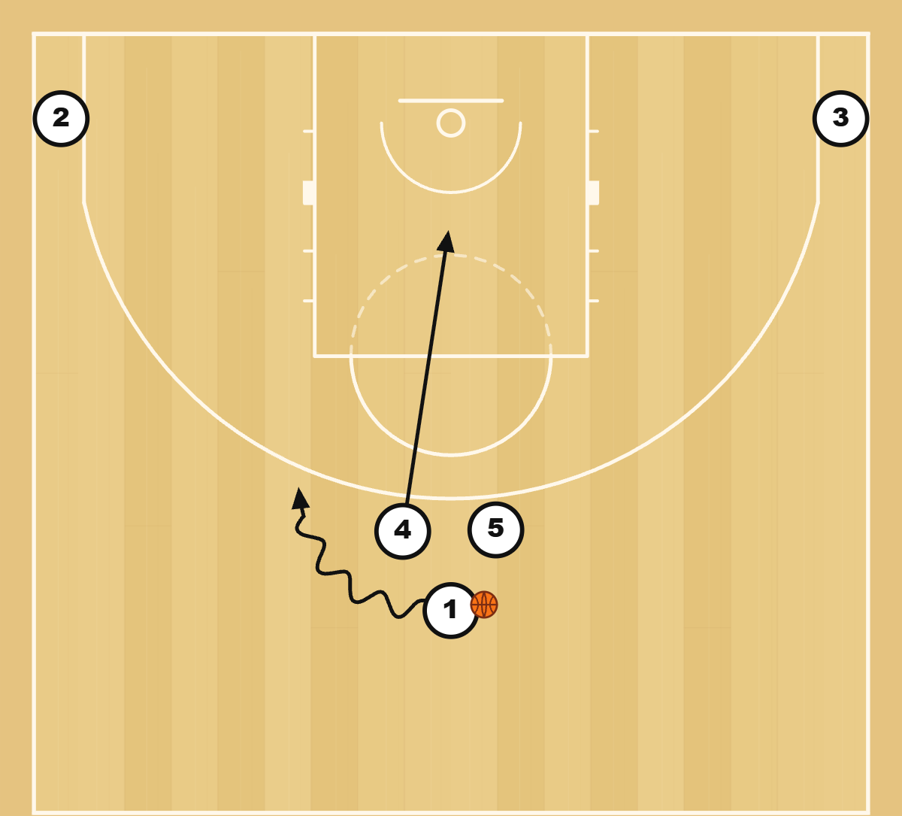
    <figcaption class="text-sm leading-relaxed text-muted-foreground">First action: 1 uses 4 and keeps the possession alive if no advantage appears.</figcaption>
  </figure>
  <figure class="m-0">
    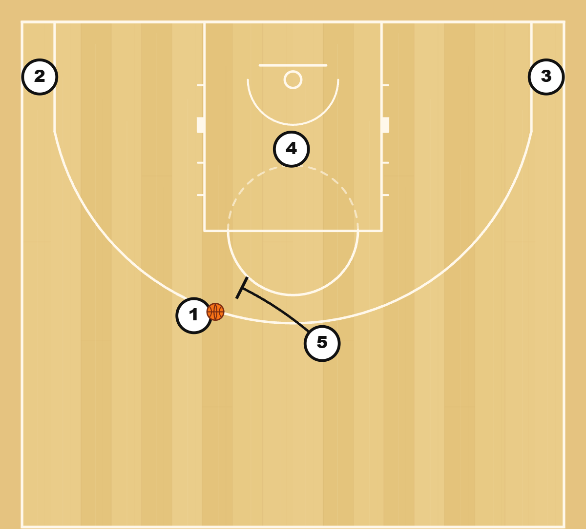
    <figcaption class="text-sm leading-relaxed text-muted-foreground">Continuation: 5 changes the screening angle; 4 must clear for the next roll.</figcaption>
  </figure>

Once 1 uses the second screen, 5 can roll. The initial screener, 4, fades out to free that lane. The diagrams show the first roll and the second screen; that subsequent clearance is essential to completing the sequence.

Timing matters more than rushing through both screens. If 5 arrives too early, the screens crowd one another. If 5 arrives late, the defender can recover before facing the next problem. A useful cue is: **“Make the defender turn again.”**

## Horns flare: free the first screener on the perimeter

The second big can also create an off-ball advantage. After 1 uses 4's ball screen, **5 sets a flare screen for 4**, who moves away from the ball to the perimeter.

  <figure class="m-0">
    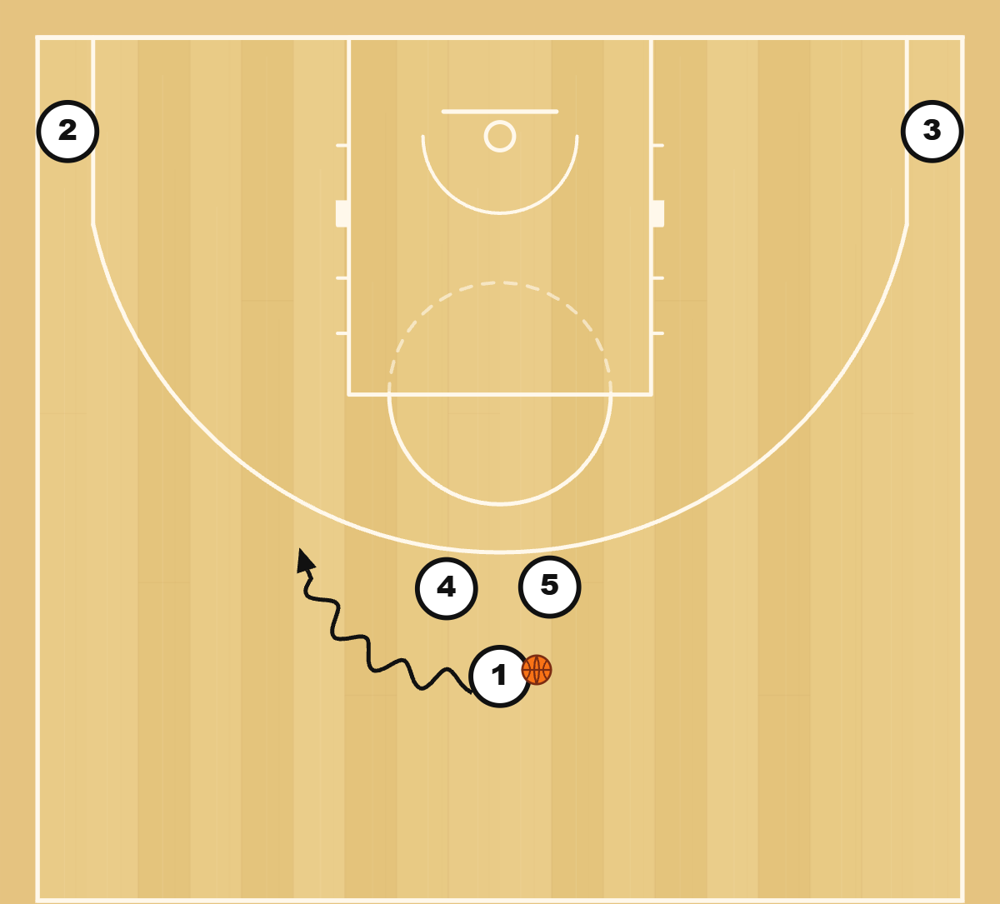
    <figcaption class="text-sm leading-relaxed text-muted-foreground">The first ball screen draws attention toward 1's drive.</figcaption>
  </figure>
  <figure class="m-0">
    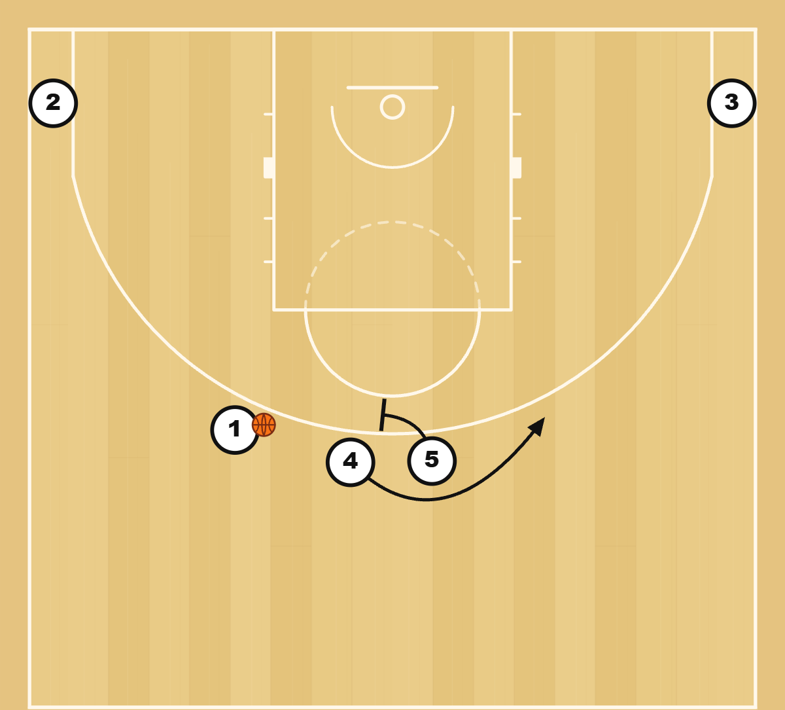
    <figcaption class="text-sm leading-relaxed text-muted-foreground">5 frees 4 on the flare, then can dive to provide the inside option.</figcaption>
  </figure>

The passer looks across the floor for 4's catch-and-shoot opportunity. After setting the flare, 5 rolls toward the basket. That creates an inside response if the defense overcommits to the shooter.

This variation fits a first screener who is a credible perimeter threat. The flare is less valuable if the defense can comfortably leave that player. Screen angle and separation still matter: drifting outward without using the screen gives the defender an easier recovery.

## Double drag: use the screens in sequence

In the double-drag variation, the ball handler starts toward a wing and uses both screens in the same direction. The defender encounters one screen, then the next.

In this example, 1 moves from right to left, passing 5's screen first and 4's second. **5 pops; 4 rolls.**

  <figure class="m-0">
    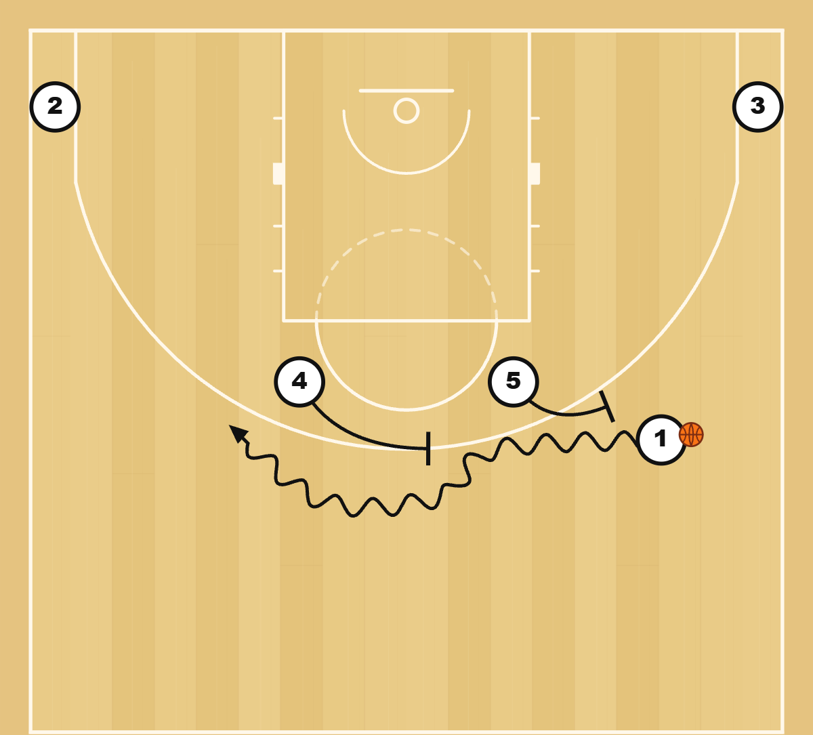
    <figcaption class="text-sm leading-relaxed text-muted-foreground">The guard uses 5 first, then 4, keeping the screens in one attacking direction.</figcaption>
  </figure>
  <figure class="m-0">
    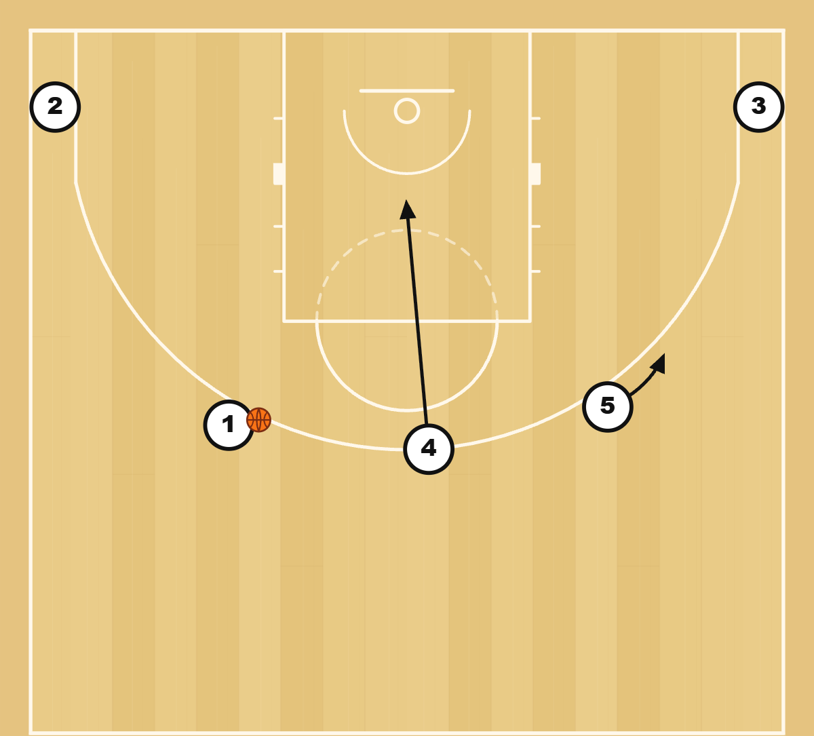
    <figcaption class="text-sm leading-relaxed text-muted-foreground">The first screener opens outside; the second creates the roll threat.</figcaption>
  </figure>

The guard should emerge with room to see the roller and the popper. Screens placed too close together can make the two defenders' jobs easier by putting everyone in the same space. The corner players stay connected to the action through their spacing and readiness for a kick-out.

## Elbow handoff: pass and follow into the next advantage

Now move the ball to the elbow. **1 passes to 5 and follows for a handoff.** The elbow receiver steps toward the pass, secures the ball, and prepares the exchange while 4 begins the opposite-side cut.

  <figure class="m-0">
    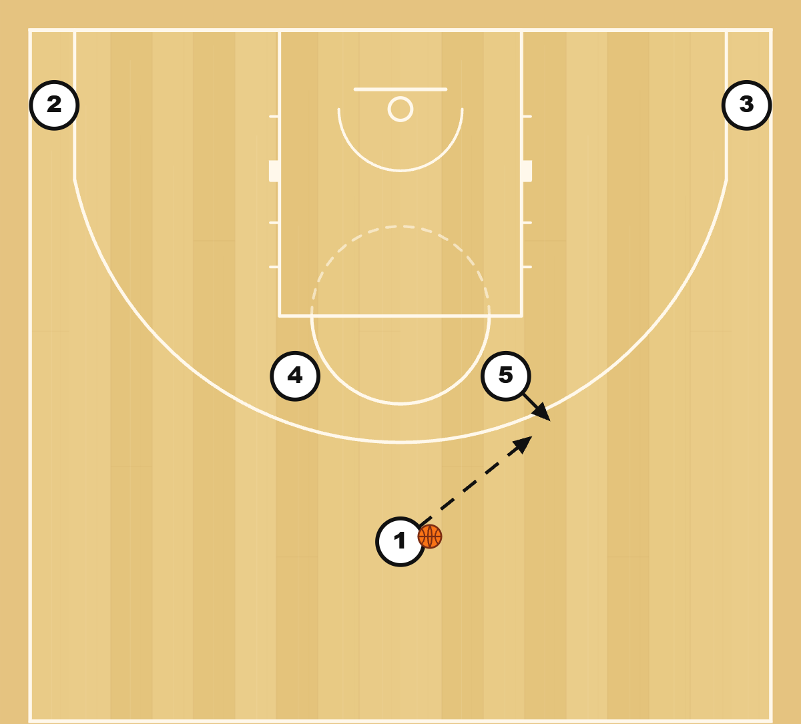
    <figcaption class="text-sm leading-relaxed text-muted-foreground">The elbow catch changes who holds the ball and where the next action starts.</figcaption>
  </figure>
  <figure class="m-0">
    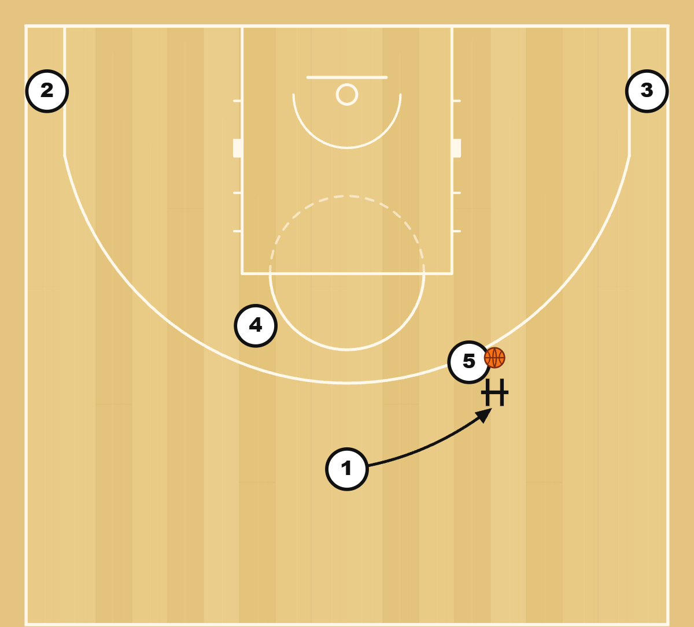
    <figcaption class="text-sm leading-relaxed text-muted-foreground">1 follows the pass and receives the ball while moving.</figcaption>
  </figure>

The handoff creates a familiar two-player problem for the defense. The receiver can turn the corner, stop for a shot when appropriate, or find the next pass. What 5 does afterward depends on where 4 is.

If 4 is still cutting into the paint, 5 can pop to preserve a clear interior target. If 4 has already cleared outside, 5 has space to roll. Agree on the version first, then allow players to recognize when the spacing permits a different continuation.

  <figure class="m-0">
    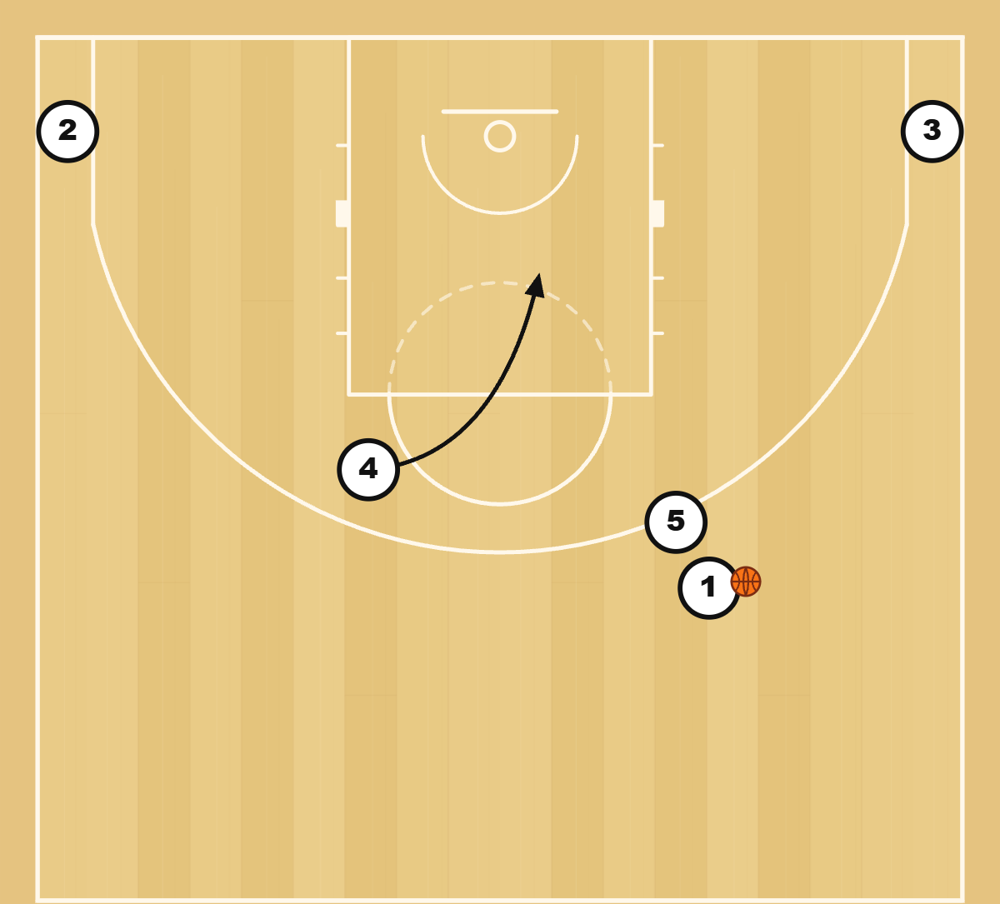
    <figcaption class="text-sm leading-relaxed text-muted-foreground">While 4 occupies the inside route, 5 can provide the outside continuation.</figcaption>
  </figure>
  <figure class="m-0">
    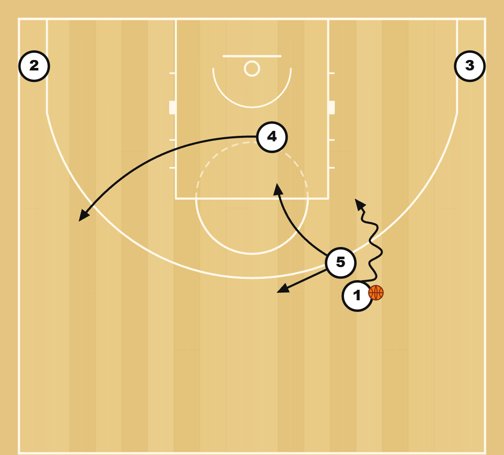
    <figcaption class="text-sm leading-relaxed text-muted-foreground">Roll and pop are alternatives. 5's choice must complement 4's location.</figcaption>
  </figure>

The common mistake is completing the exchange and then stopping. The handoff should lead directly into a drive, shot, pass, or another screening action while the defense is still adjusting.

## Split action: a cut or flare after the elbow entry

After passing to 5, 1 can use an off-ball screen from 4. The elbow passer stays available to deliver the ball while the two teammates separate into different spaces.

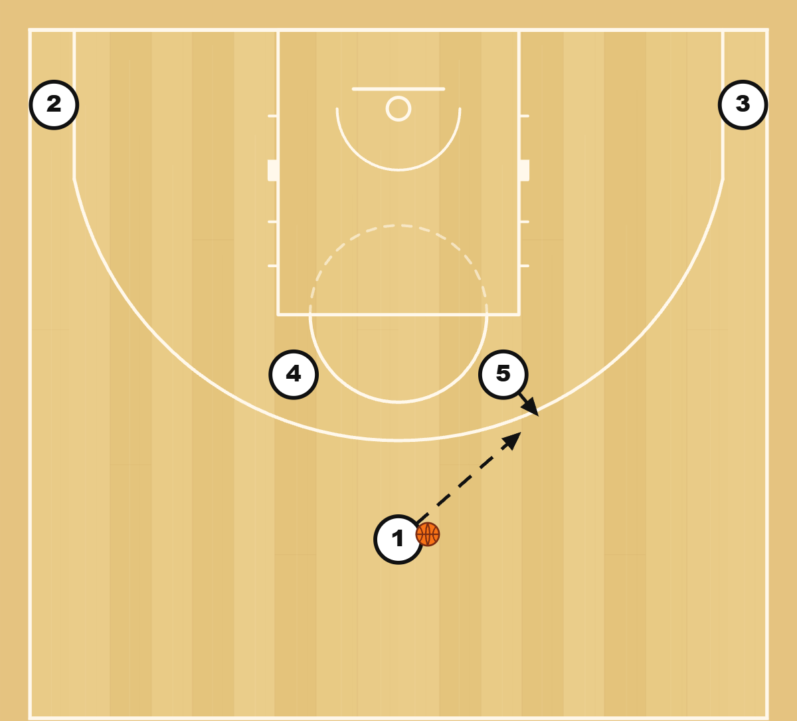

The two examples below show different responses. **1 can cut toward the basket off 4, or flare outside while 4 rolls.** The route depends on the action's intent and the defender's positioning.

  <figure class="m-0">
    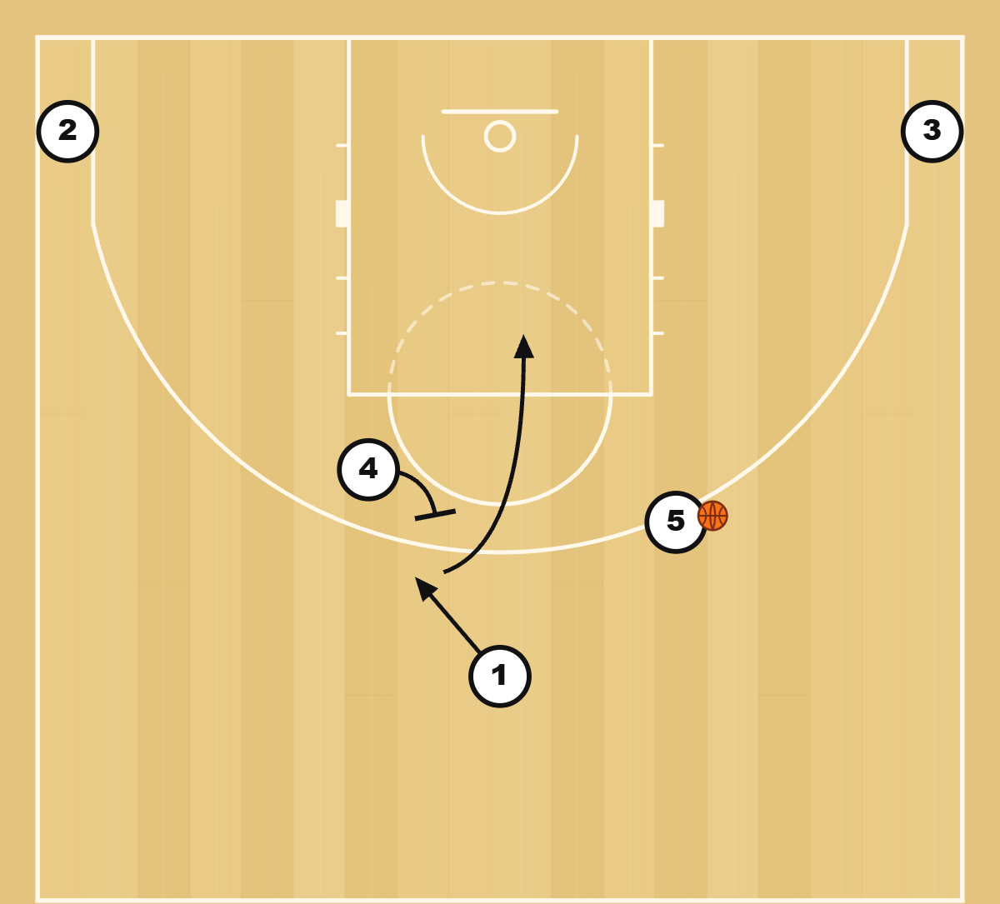
    <figcaption class="text-sm leading-relaxed text-muted-foreground">Cut option: 1 attacks the inside lane and gives 5 a moving target.</figcaption>
  </figure>
  <figure class="m-0">
    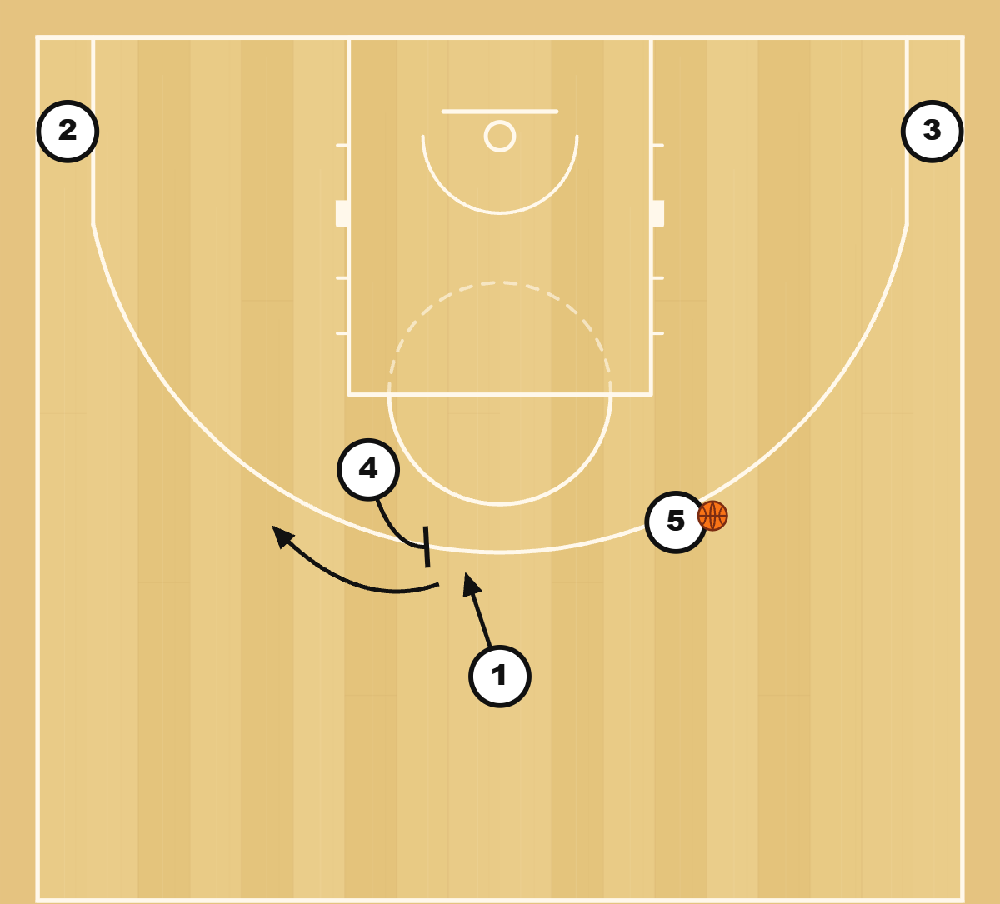
    <figcaption class="text-sm leading-relaxed text-muted-foreground">Flare option: 1 separates outside while 4 creates the interior threat.</figcaption>
  </figure>

The passer needs an angle to see both options. The cutter must set up the defender and use the screen closely enough to create separation. Against a switch, look for a brief seal or mismatch before forcing a pass through traffic.

The useful coaching question is: **“Which space did the defender give you?”** That keeps the action connected to a read, even when the team calls a specific starting route.

## High-low: use the elbow as a passing window

The high-low variation puts one big at the elbow with the ball and the other close to the rim. After the entry to 5, **4 dives and establishes an inside seal**.

  <figure class="m-0">
    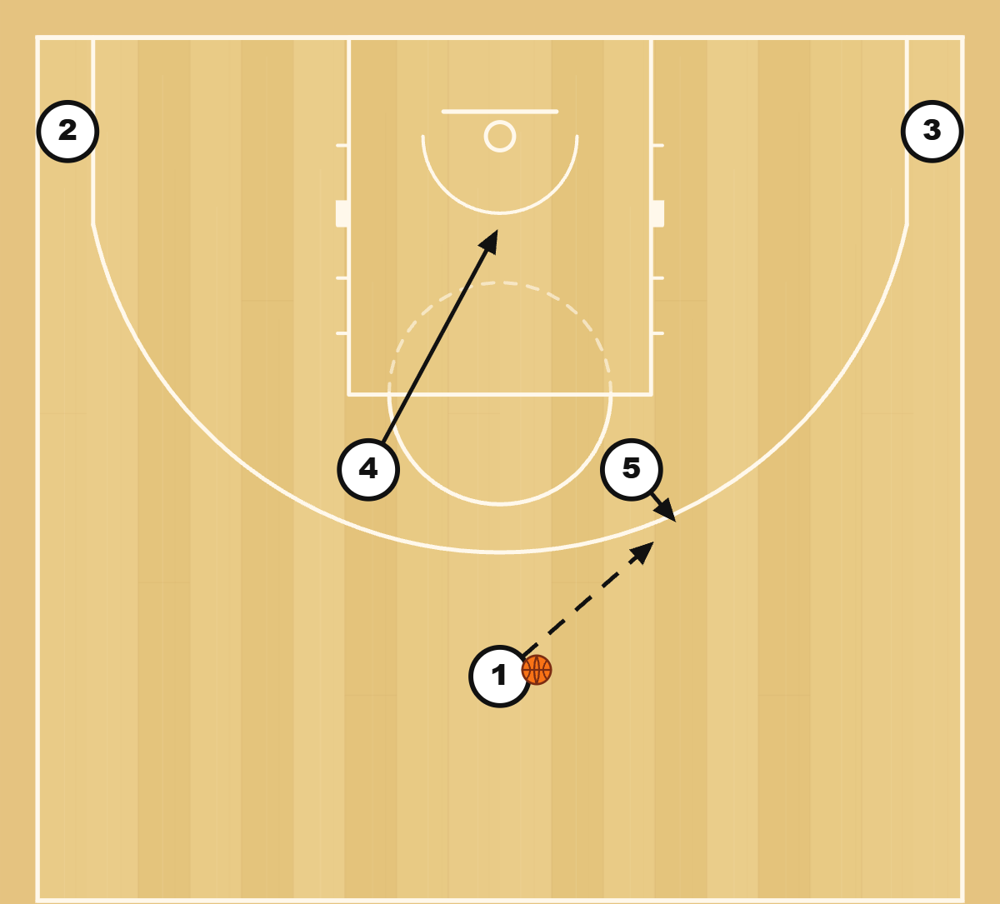
    <figcaption class="text-sm leading-relaxed text-muted-foreground">The opposite big moves inside as the elbow receives the ball.</figcaption>
  </figure>
  <figure class="m-0">
    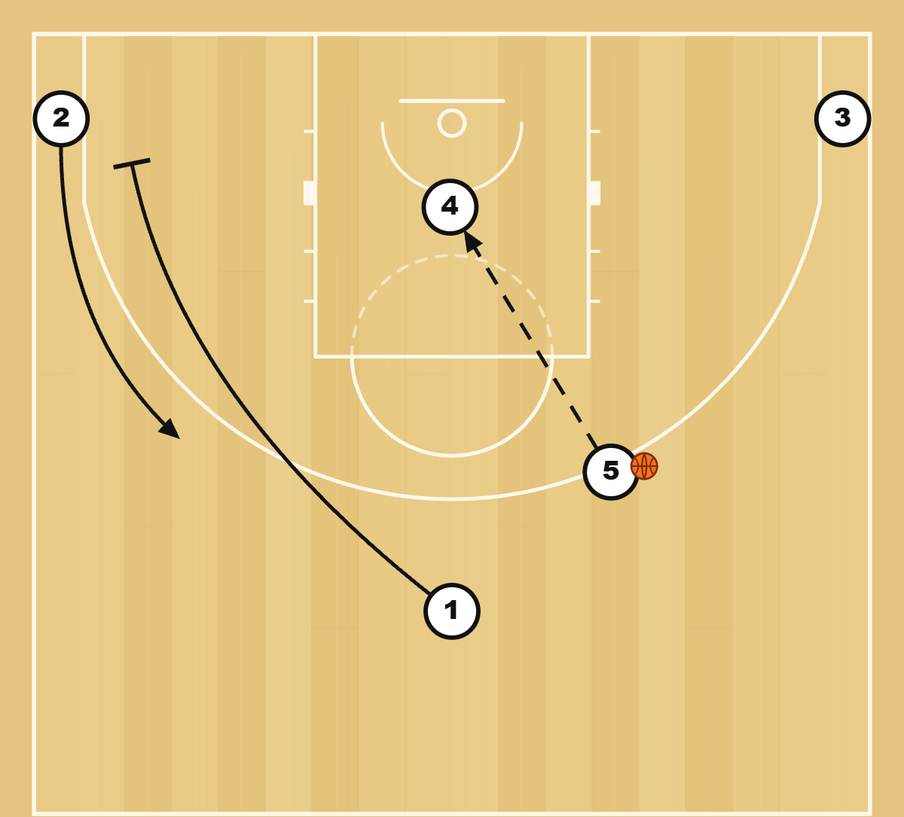
    <figcaption class="text-sm leading-relaxed text-muted-foreground">5 reads the inside seal; 1 and 2 exchange to keep the off-ball defense occupied.</figcaption>
  </figure>

Passing from the middle gives the elbow player a view of the seal and the help on both sides. The low player must hold a usable angle rather than simply reach the block. The passer reads the defender's position and chooses an appropriate delivery.

The exchange between 1 and 2 adds movement away from the ball. It can make helping less comfortable, but the passer still needs to locate that help before releasing the entry. If the seal is covered, the offense can move the ball or continue into a handoff instead of forcing it inside.

## Horns Zoom: connect a down screen with a handoff

Horns also offers a natural entry into **Zoom action**. In this version, **1 enters to 4 at the left elbow, fakes the handoff, and clears left. On the opposite side, 5 down-screens for 3.**

Player 3 rises off the screen toward a dribble handoff from 4, who brings the ball across to meet the receiver. The defender must deal with the down screen and the exchange in quick succession.

  <figure class="m-0">
    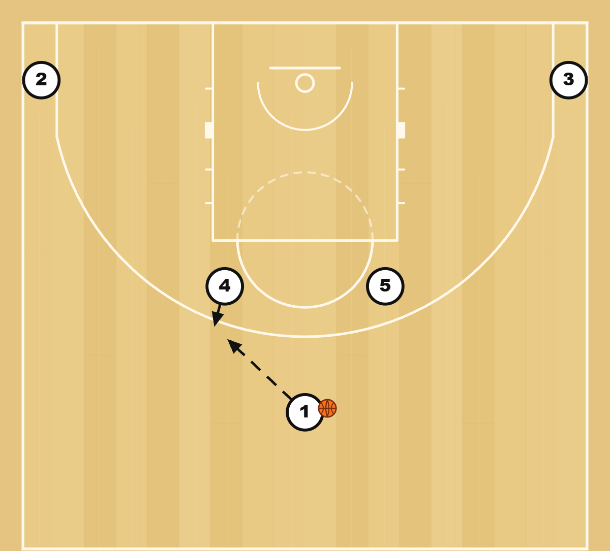
    <figcaption class="text-sm leading-relaxed text-muted-foreground">The elbow entry provides the same starting picture as the other off-ball options.</figcaption>
  </figure>
  <figure class="m-0">
    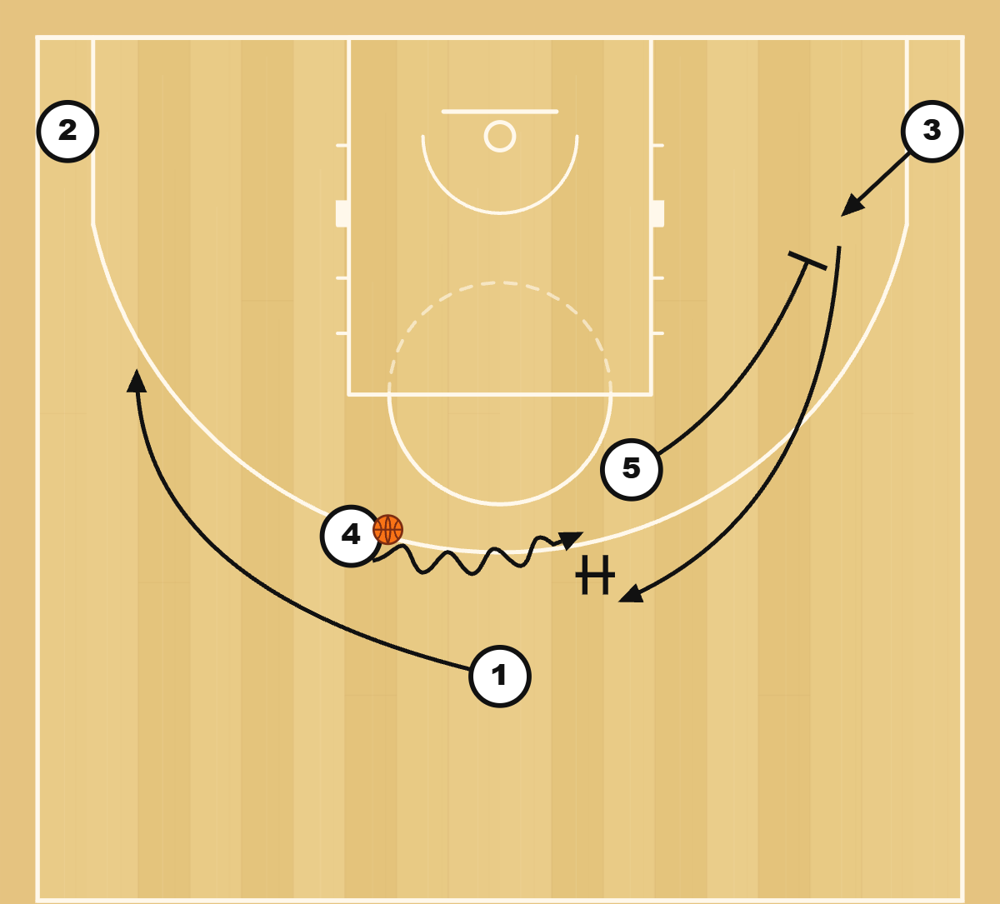
    <figcaption class="text-sm leading-relaxed text-muted-foreground">3 comes up off 5's screen and meets 4 for the handoff.</figcaption>
  </figure>

The connection between the two actions creates the pressure. A long pause after the down screen gives the defender time to recover. An early handoff can leave the receiver too far away to use it effectively.

Once 3 receives the ball, the familiar reads return: turn the corner, take an available shot, or move the ball when help commits. The [full Zoom Action guide](/blog/zoom-action) explores those continuations in more detail.

## The spacing and timing details that make Horns work

The variations share a few practical requirements:

- **Give each big a clear next job.** Roll, pop, flare, or screen again. Two players arriving in the same space remove a passing option.
- **Keep the corners useful.** Their spacing stretches help, and their readiness matters when that help leaves.
- **Use the screen before looking for the next action.** The handler's route and pace determine whether the defender has a problem to solve.
- **Move as the ball arrives.** An elbow catch should lead into its cut, screen, or handoff without an unnecessary reset.
- **Match the variation to the players.** A flare needs a credible receiver; high-low needs an inside seal and a passer who can read it.
- **Keep an outlet when the first option closes.** A reversal or connected second action can preserve the possession's advantage.

You do not need to introduce every variation at once. Start with a ball-screen option and an elbow-entry option that fit your players. Add a continuation when the team understands the spacing behind those first choices. The [basketball practice-planning guide](/blog/basketball-practice-planning) can help connect that focus to the rest of your session; the [Drill Library](/drills) provides activities you can adapt to the reads you want to develop.

## Key takeaways

1. **Horns gives several entries from one alignment.** The two elbows and two corners create the starting spacing.
2. **The bigs' movements must complement each other.** In the variations shown, an inside threat is paired with an outside option or clearance.
3. **The second screen changes the problem.** A twist attacks a new angle; double drag uses consecutive screens in one direction.
4. **Elbow entries involve the passer and cutters.** Handoffs, split action, and high-low all depend on movement around the catch.
5. **Zoom links two actions.** The down screen and handoff should arrive as one connected sequence.
6. **The defense decides which option becomes available.** The setup supports the read; the players still have to make it.

## Keep the Horns guide beside your playbook

Use the <a href="https://www.youtube.com/watch?v=TX8U5Zav8e4" target="_blank" rel="noopener noreferrer">Horns Offense video</a> to see the timing and the free <a href="https://guide.bballorbit.com/horns" target="_blank" rel="noopener noreferrer">Horns Offense PDF Guide</a> as a quick reference for the actions and their spacing. This article supplies the reasoning you can return to when choosing a variation for your team.

## Turn the action into a clear plan for your team

Choose the Horns entry you want to use, make each player's next movement explicit, and decide what the team should read when the defense takes away the first option.

  

    <h3 class="mt-0 !text-primary">Draw your Horns actions and organize the teaching points</h3>
    
Use the Drill Creator in the Basketball Orbit app to draw your Horns alignment, separate the phases, and show how the roll, pop, or handoff connects to the next action.

    
The <a href="https://app.bballorbit.com/">Practice Planner</a> keeps those visuals alongside the timing and coaching cues for your session, so the action has a clear place in your practice.

    
<a href="https://app.bballorbit.com/">Build your Horns practice in Basketball Orbit</a>

  

  

    <a href="https://app.bballorbit.com/">
      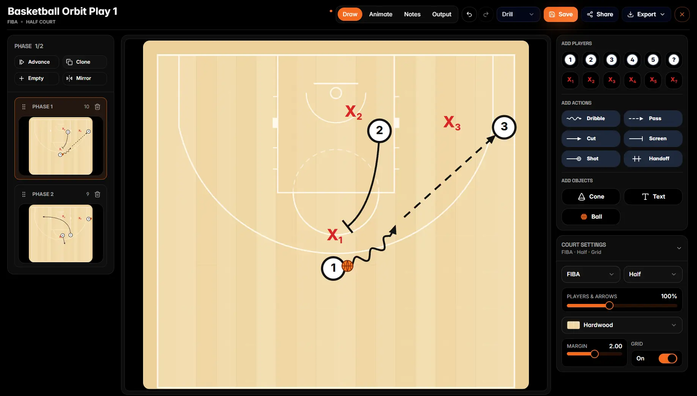
    </a>
  

